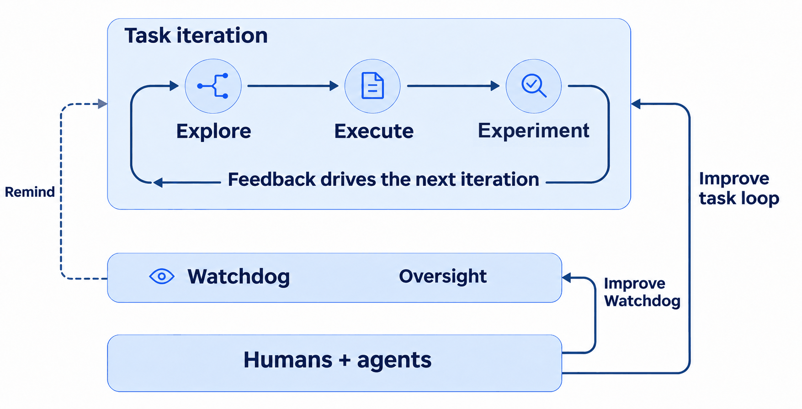

<h1 align="center">
  <picture>
    <source media="(prefers-color-scheme: dark)" srcset="docs/assets/fore-rsi-dark.png">
    
  </picture>
</h1>

<p align="center">An RSI framework built on Agent Teams that autonomously explore approaches in parallel, execute work, and run experiments, with feedback driving continuous improvement.</p>

<p align="center">English · <a href="README_zh.md">简体中文</a></p>

ForeRSI is a recursive self-improvement (RSI) framework built on Agent Teams. With objectives and constraints defined, teams can autonomously explore approaches in parallel, collaborate on execution, run experiments, and refine their approaches and working methods through feedback.

ForeRSI uses decentralized collaboration: agents communicate directly and share progress, reducing information bottlenecks so independent work can move forward in parallel.

Users provide objectives, materials, constraints, resources, and a time budget; a workflow organizes the team around them. See the [documentation](docs/README.md) for command-line usage and development guides.

## Quick start

### Install

Install with [uv](https://docs.astral.sh/uv/), which prepares the Python 3.13 environment:

```bash
uv tool install --python 3.13 fore-rsi
```

<details>
<summary>Use pip instead</summary>

Run in a Python 3.13 or later environment:

```bash
pip install fore-rsi
```

</details>

<details>
<summary>Editable installation from a checkout</summary>

Source builds require [Rustup](https://rustup.rs/) and the platform's C/C++ build tools. Installation prepares the required Rust and Zig toolchains and compiles the built-in terminal.

From the ForeRSI repository root, let uv manage the Python environment:

```bash
uv tool install --python 3.13 -e .
```

The editable installation uses the local Python source directly. No virtual environment activation is needed.

Or use pip in a virtual environment. On macOS, keep the environment outside protected folders such as Desktop so the background terminal can start. The checkout can stay where it is.

```bash
python3.13 -m venv "$HOME/.venvs/fore-rsi"
source "$HOME/.venvs/fore-rsi/bin/activate"
pip install -e .
```

Activate that environment before running `fore-rsi`.

</details>

<details>
<summary>Update or uninstall</summary>

For a published release installed with uv:

```bash
# Update
uv tool upgrade fore-rsi

# Uninstall
uv tool uninstall fore-rsi
```

For a published release installed with pip:

```bash
# Update
pip install --upgrade fore-rsi

# Uninstall
pip uninstall fore-rsi
```

After changing dependencies, native code, or build configuration in a source checkout, reinstall from the repository root:

```bash
uv tool install --python 3.13 --reinstall -e .
```

For a pip editable installation, run `pip install -e .` in the original environment. Use the same uninstall commands as for a published release.

[Exit ForeRSI](#exit-and-resume) before updating or uninstalling. After updating, resume a saved session to use the new version. Uninstalling retains saved session data.

</details>

<details>
<summary>Use a network proxy</summary>

If your connection needs a proxy, set these variables before installing or running commands. Replace `http://127.0.0.1:7890` with your HTTP proxy's address:

```bash
export HTTP_PROXY=http://127.0.0.1:7890
export HTTPS_PROXY=http://127.0.0.1:7890
export NO_PROXY=localhost,127.0.0.1,::1
```

</details>

### Choose a workflow and start

Start in the project directory you want to work with. The built-in `default` workflow opens a native Pi conversation with the Coordinator. Give the session a name so you can return to it later:

```bash
fore-rsi --session sglang-throughput
```

ForeRSI reuses an installed CLI or runs the selected backend's official installer when needed. Follow any installer prompts to prepare dependencies; sign in through the native tool when authentication is required.

You can also [design a custom RSI workflow](#design-a-custom-rsi-workflow) with the roles, tools, execution steps, and evaluation criteria your task needs. See the [CLI reference](docs/cli.md) for options, or run `fore-rsi --help`.

### Provide a task

Describe the task directly in the terminal conversation, or supply a Markdown file at startup with `--task`.

In the conversation, tell the Coordinator your objective, constraints, available resources, time budget, and expected deliverables. For example:

> Optimize BF16 Qwen3.5-35B-A3B on SGLang at request concurrency 1 and 16. Increase output token throughput and reduce time per output token (TPOT) while preserving answer quality. Use at most two NVIDIA A100 GPUs on one host, with a 24-hour budget.
>
> Team concurrency: 4 Explorers, 4 Workers, 2 Experimenters.

If you already have a task file, provide it when starting. For example, run the [SGLang throughput task](tasks/inference-optimization/sglang-throughput.md) from the ForeRSI repository root:

```bash
fore-rsi --session sglang-throughput \
  --task tasks/inference-optimization/sglang-throughput.md
```

Replace the path with your own task file as needed. Relative paths are resolved from the directory where you run the command. With either input method, you can continue sharing materials and refining requirements in the conversation.

### Exit and resume

Press `Ctrl+B`, release it, then press `q` to exit. Inside an agent conversation, `Ctrl+C` interrupts the current turn.

List sessions with their workflow names, workflow states, and terminal server status:

```bash
fore-rsi list
```

Resume a saved session by name:

```bash
fore-rsi --session sglang-throughput
```

The session resumes its saved workflow and task progress. You do not need to pass `--task` again.

### Stop a session

Stop a session while keeping its data:

```bash
fore-rsi stop --session sglang-throughput
```

### Delete a session

Delete a named session when you no longer need it:

```bash
fore-rsi delete --session sglang-throughput
```

## The improvement loop

<p align="center">
  
</p>

### Task iteration

1. Explore approaches: examine the available materials and possible paths against the objectives and constraints, then develop an actionable plan.
2. Execute the plan: carry out the work and produce code, configuration, analyses, documents, or other outputs ready for experiments.
3. Run experiments: gather feedback through tests, measurements, simulations, or human review, assess the outcome against the objectives and constraints, and decide what to retain or revise.

Feedback guides the next round of exploration and execution. The team can also request feedback during exploration.

The Coordinator connects user requirements with task progress, while the Checker reviews plans, work, and conclusions at relevant stages. Through the Coordinator, users can share materials, refine requirements, and adjust the direction of the task.

### Watchdog: oversight and reminders

The Watchdog periodically reviews task progress and team collaboration, identifies stalled work, repeated attempts, and handoff problems, alerts the members responsible, and follows up on their actions. It focuses on the effectiveness of the overall workflow and captures reusable lessons.

### Humans and agents: improve the task loop and Watchdog

Humans and agents use task experience and Watchdog feedback to improve both the task workflow and the Watchdog's oversight and reminders. These improvements are designed, implemented, and validated before being applied to subsequent work.

## Design a custom RSI workflow

A workflow defines team roles, tools, execution steps, and handoff rules. It can also carry domain prompts, reference materials, knowledge, methods, and evaluation criteria. Organize the team around the task to apply the improvement loop in different fields:

- Software development: implement features or algorithms and refine them through testing and feedback.
- Inference optimization: improve code, configuration, and runtime performance in systems such as Foretoken, SGLang, and vLLM.
- Scientific research: combine domain literature, data, simulations, and expert review.

## Contributing

Contributions to ForeRSI are welcome. See the [contribution guide](CONTRIBUTING.md) for local development, validation, and pull requests.

Thank you to all [contributors](https://github.com/shiweijiezero/fore-rsi/graphs/contributors) who help improve ForeRSI through code, documentation, ideas, and feedback.

## License

[Apache License 2.0](LICENSE).
